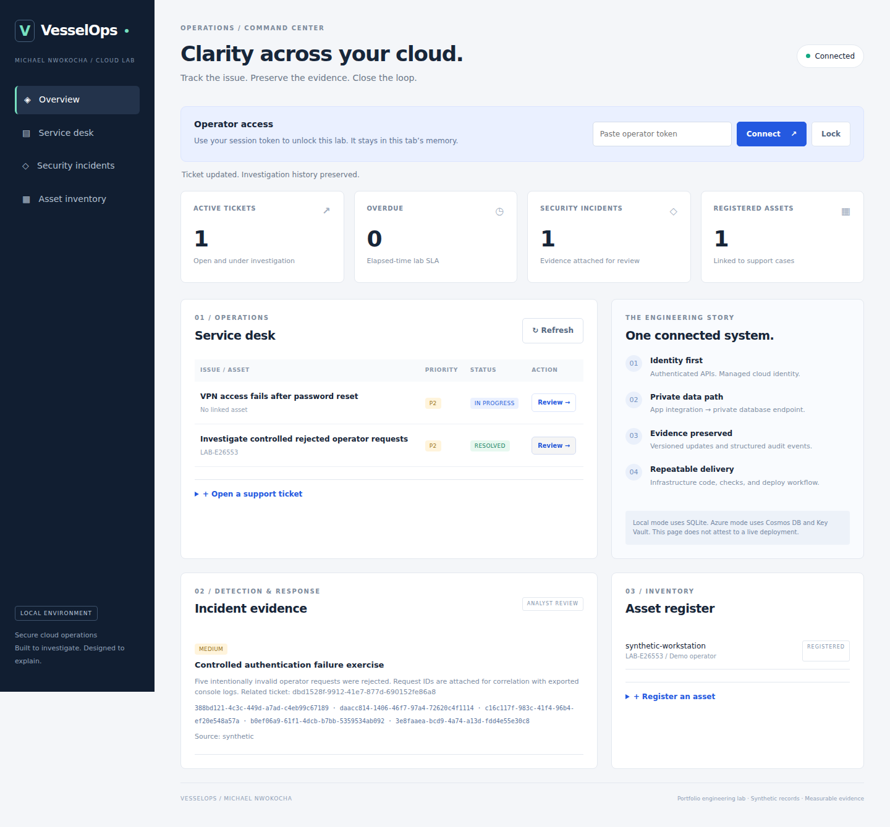
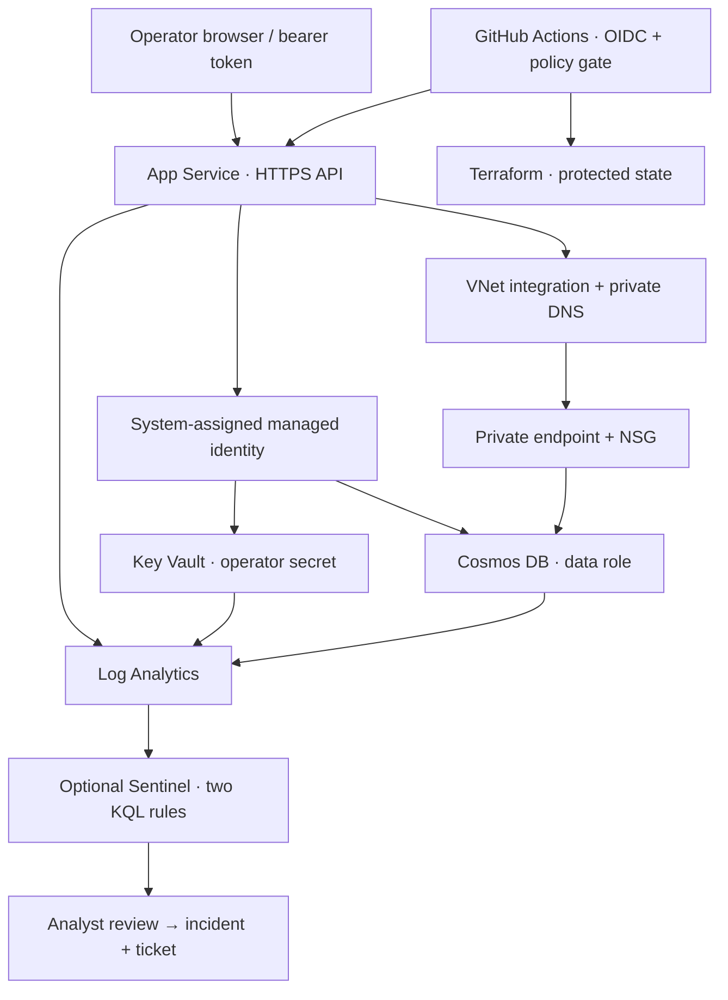

# VesselOps — Secure Cloud Operations Capstone

**Michael Nwokocha · IT operations, cloud identity, detection and response**

A working operations console that connects an IT issue to an asset, preserves investigation history, records security evidence, and runs locally or against an Azure private database. This is a portfolio engineering lab, not a production service.



## Start here

Read `START_HERE.md` for the shortest path through the project.

**What is built:** Flask application and browser console; SQLite local persistence; Cosmos DB adapter; Azure Terraform configuration; managed identity and secret access; logging and optional Sentinel rules; GitHub Actions validation and OIDC deployment workflows; Azure ARM export/audit tools; Azure/AWS log triage; a controlled incident scenario; runbooks and tests.

**What is not yet demonstrated:** an actual deployment in Michael's Azure subscription, a GitHub Actions run, real cloud telemetry ingestion, cloud cost measurements, or Michael personally completing the exercises. Local test results and screenshots are included with explicit provenance. Read `evidence/VALIDATION.md` for exact verification status.

## Run it on your computer

Python 3.12 is the tested runtime. From this folder:

```sh
python3 -m venv .venv
source .venv/bin/activate
python -m pip install -r requirements-dev.txt
python tools/local.py
```

On Windows, create the environment with `py -3.12 -m venv .venv`, activate with `.venv\Scripts\Activate.ps1`, then use the same `python` commands. Open http://127.0.0.1:8080 and paste the session token printed by the local launcher. The token stays in browser memory; Lock clears it and displayed records. The server binds to localhost. Do not expose the Flask development server to a network.

Create an asset and a ticket in the UI. Review the ticket, document investigation and resolve it. To run the connected security exercise, open a second terminal with the same virtual environment and set `API_TOKEN` to your session token in that terminal. Do not put your token in a repository or command-line argument.

```sh
python tools/scenario.py --base-url http://127.0.0.1:8080
python tools/azure_triage.py fixtures/azure_console.json --output evidence/my_azure_triage.json
python tools/aws_triage.py fixtures/aws_cloudtrail.json --output evidence/my_aws_triage.json
python tools/azure_audit.py fixtures/azure_secure.json --fail-on-high
pytest --cov=app --cov-report=term-missing
```

The scenario sends five deliberately invalid requests **only to your chosen own instance**, confirms rejection, creates an investigation ticket, resolves it as controlled activity, and attaches the observed request IDs to an incident. It does not simulate a compromise or prove an attack was prevented.

## Architecture



The public website exposes the shell and liveness endpoint; all operational read/write APIs require the operator token. App Service VNet integration is an outbound data path, not private inbound hosting. Cosmos public network access and account-key authentication are disabled. Key Vault has a public endpoint protected by RBAC in this lab; the runtime role is scoped to the one operator-token secret. The Cosmos role covers the dedicated lab account. Neither cloud networking nor RBAC has been live-verified yet.

## What makes this a useful interview project

| Engineering decision | Observable proof |
| --- | --- |
| Passwordless database access | Runtime uses managed identity; Terraform disables Cosmos local auth |
| Private database traffic | VNet integration, private endpoint, DNS link, subnet NSG; live verification runbook |
| Conflicting operator updates | SQLite compare-and-swap / Cosmos ETag; stale request returns 409 |
| Explicit failure handling | Missing inventory fails coverage; denied APIs return 401; unexpected errors omit secrets |
| Connected investigation workflow | Controlled failed requests → request IDs → ticket history → incident evidence |
| Deployment guardrail | Bad fixture rejected; plan JSON evaluated before applying |
| Honest scope | Separate synthetic evidence, SDK contract tests and pending cloud checks |

## Repository map

- `app/`, `wsgi.py`: console, authenticated API, document stores.
- `infra/`: pinned Azure Terraform, optional Sentinel, budget and provider-mocked tests.
- `.github/workflows/`: CI and manual deploy/destroy using OIDC.
- `tools/`: collector, auditors, triage, packaging, scenario and bootstrap helpers.
- `detections/`: KQL for app authentication failures and denied Key Vault secret access.
- `fixtures/`: explicitly synthetic exports; safe to publish.
- `docs/DEPLOY_AZURE.md`: account setup, first deployment, CI setup, readiness and cleanup.
- `docs/THREAT_MODEL.md`, `docs/INCIDENT_RUNBOOK.md`: reasoning, tradeoffs and investigation.
- `docs/PORTFOLIO.md`: personal exercises, evidence checklist, resume wording and walkthrough.

This implementation builds on the supplied **Jhante Charles Lab Path Combined Capstone Plan** concept, with a redesigned application/data layer. It uses managed Cosmos DB instead of Azure SQL/VMs so database access can be passwordless without a separate SQL bootstrap. It does not claim to reproduce or complete Jhante's published labs. AWS support here is an export analyzer, not a deployed AWS equivalent.

Read `docs/SOURCES.md` for primary design references. AI-assisted starting implementation; Michael's modifications and personal completion evidence should be recorded in `docs/MY_BUILD_LOG.md`.
